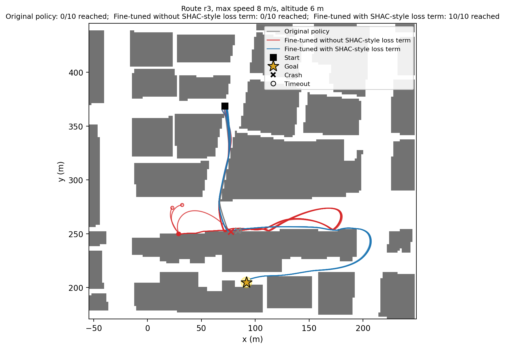

# Learning to Detour

A reactive, vision-based quadrotor policy that learns to fly around obstacles it cannot
yet see past. It builds on [DiffPhysDrone](https://github.com/HenryHuYu/DiffPhysDrone)
(Zhang et al., *Learning vision-based agile flight via differentiable physics*, Nature
Machine Intelligence 2025) and adds three things to its training:

1. **Time-to-contact input.** The policy sees TTC (depth / forward speed) instead of depth.
2. **Velocity-aligned heading.** The camera follows the flight direction instead of always
   facing the goal, so while the drone flies around a building it can see where it is going.
3. **SHAC fine-tuning** ([Xu et al., ICLR 2022](https://arxiv.org/abs/2204.07137)). A learned
   critic gives the policy credit for decisions that only pay off seconds later, such as
   turning away early to get around a building. This sits on top of the original
   differentiable-physics losses.

The policy's inputs and outputs are unchanged, so it runs exactly like the original at test time.

## Results

Zero-shot evaluation in an unseen photorealistic city (Isaac Sim 5.1 + Pegasus, NVIDIA City
Demo Pack). Each route is flown at 4, 6, 8, 10 and 12 m/s, with 10 episodes per speed.

| Route | Original policy | Fine-tuned, no SHAC | Fine-tuned, SHAC (ours) |
|---|---|---|---|
| Open street (112 m) | 100% | 100% | **100%** |
| Turn (103 m straight, 116 m shortest) | 0% | 62% | **96%** |
| Detour (165 m straight, 310 m shortest) | 0% | 0% | **100%** |

Success = within 5 m of the goal without a collision, within 140 s. Full tables, with
collision and timeout rates, time to goal and path ratio, are in [results/](results/).



## Layout

```
main_cuda_shac.py      SHAC fine-tuning (TTC input, velocity heading, SHAC + DiffPhys losses)
shac.py                critic network, SHAC actor loss, critic TD(lambda) update
env_cuda.py            differentiable training simulator (from DiffPhysDrone)
rigid_body.py          rigid-body dynamics used by env_cuda.py
model.py               policy network (from DiffPhysDrone)
src/                   CUDA kernels for the simulator (from DiffPhysDrone)
configs/               training arguments
isaac/isaac_eval.py    zero-shot evaluation in Isaac Sim + Pegasus
checkpoints/           base/  original TTC policy (SHAC starts from this)
                       ctrl/  fine-tuned without SHAC (control)
                       shac/  fine-tuned with SHAC (ours), plus its critic
results/               tables and figures from the Isaac evaluation
```

## Setup

Tested with Python 3.11 and PyTorch 2 + CUDA. Build the simulator's CUDA ops:

```bash
pip install -e src
```

## Training

From the repo root:

```bash
python main_cuda_shac.py $(cat configs/single_agent.args) --use_ttc \
    --resume checkpoints/base/cmd_checkpoint0000.pth
```

Checkpoints go to `checkpoints/shac/` and logs to TensorBoard (`runs/`). The critic is trained
alone for the first 300 windows (`--critic_warmup_windows`) before the policy is updated.

## Evaluation in Isaac Sim

Requires Isaac Sim 5.1, [Pegasus Simulator](https://github.com/PegasusSimulator/PegasusSimulator)
and the NVIDIA AECO City Demo Pack (`World_CityDemopack.usd`). Run with Isaac's Python:

```bash
export CITY_USD=/path/to/CityDemopack/World_CityDemopack.usd
/isaac-sim/python.sh isaac/isaac_eval.py --headless \
    --resume checkpoints/shac/shac_checkpoint_orig_03000.pth \
    --start 71.8 368.7 --goal 91.8 204.7 --max_speed 8 --out eval/detour/shac/v8

# original policy (trained facing the goal)
/isaac-sim/python.sh isaac/isaac_eval.py --headless --heading goal \
    --resume checkpoints/base/cmd_checkpoint0000.pth \
    --start 71.8 368.7 --goal 91.8 204.7 --max_speed 8 --out eval/detour/base/v8
```

Routes used for the results (start → goal, x y in metres):

| Route | Start | Goal |
|---|---|---|
| Open street | 829.8 -381.3 | 941.8 -381.3 |
| Turn | -608.2 496.7 | -704.2 460.7 |
| Detour | 71.8 368.7 | 91.8 204.7 |

Add `--record` to save a chase-camera video of the first episode.

## Acknowledgements

The training simulator (`env_cuda.py`, `src/`) and the policy network (`model.py`) come from
[DiffPhysDrone](https://github.com/HenryHuYu/DiffPhysDrone). Please cite their work:

```
@article{zhang2025learning,
  title={Learning vision-based agile flight via differentiable physics},
  author={Zhang, Yuang and Hu, Yu and Song, Yunlong and Zou, Danping and Lin, Weiyao},
  journal={Nature Machine Intelligence},
  pages={1--13},
  year={2025},
  publisher={Nature Publishing Group}
}
```
